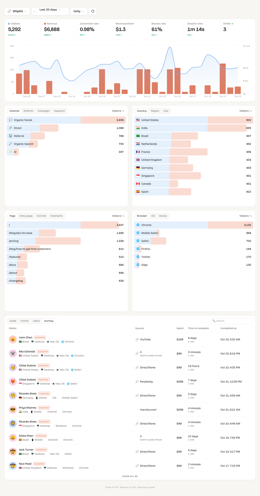

# Minilytics

Revenue-first web analytics for your own websites, inspired by DataFast. It shows where visitors came from (which
tweet, article, Google page or AI assistant), what they did, and **which source made you money**. It runs on
Cloudflare's free plan.



## What it tracks

- **Visitors, revenue, conversion rate, revenue per visitor, bounce rate, session time, online now**, each with a % change against the previous period
- A chart of visitors (line) and revenue (bars), hourly, daily, weekly or monthly
- Date ranges: today, yesterday, last 24h, last 2 days, 7/30/90 days, 12 months, all time and custom, with ‹ › to step back and forward
- **Where visitors come from**: channel, referrer (X, Google, ChatGPT, Reddit…), campaign (`utm_campaign`), keyword (`utm_term`), `?ref=` tags
- **Where they are and what they use**: country, region, city, browser, OS, device
- **What they did**: pages, entry pages, exit links (outbound clicks), button clicks and custom goals, funnels
- **Who paid**: a Journey list of every customer with their source, amount, time to convert, and a full visitor timeline (visit → pages → clicks → payment)
- Click any row to filter the whole dashboard (for example "only visitors from the launch tweet")
- Multiple websites, one login

## Deploy for free (about 10 minutes)

You need a free Cloudflare account and Node 20+.

```bash
npm install
npx wrangler login

# 1. Create the database, then paste the printed database_id into wrangler.jsonc
npx wrangler d1 create minilytics

# 2. Set your dashboard password and a random signing secret
npx wrangler secret put ADMIN_PASSWORD
npx wrangler secret put SESSION_SECRET      # any long random string, e.g. `openssl rand -hex 32`

# 3. Build, create the tables and deploy
npm run deploy
```

Open the URL Wrangler prints (`https://minilytics.<you>.workers.dev`), log in, add a website and copy its script tag.
You can attach a custom domain such as `analytics.yourdomain.com` in Cloudflare → Workers → Settings → Domains.

To update later: `git pull && npm run deploy`.

### What the free plan covers

| Cloudflare free limit | What it means here |
| --- | --- |
| 100,000 Worker requests/day | About 100k tracked events per day across all sites. The script and dashboard files are static and don't count. |
| 100,000 D1 rows written/day | About 10k pageviews per day |
| 5M D1 rows read/day | A dashboard load reads roughly 10 times the sessions in the range, so with 10k visitors/month that's hundreds of loads a day |
| 5 GB D1 storage | Years of data at side-project traffic |

At 5–10k visitors a month you'll use a few percent of this. If you outgrow it, Cloudflare's Workers Paid plan is $5/month.

## Install on a website

```html
<script defer data-website-id="SITE_ID" src="https://YOUR-MINILYTICS-HOST/js/script.js"></script>
```

- **Button clicks / goals:** `<button data-ml-goal="signup_click">`, or `window.minilytics('goal', 'signup', { plan: 'pro' })`
- **Identify logged-in users:** `window.minilytics('identify', { user_id, email, name })`
- **Ignore your own visits:** open `https://yoursite.com/?ml_ignore=true` once per browser
- **Single-page apps** (Next.js, React Router…) are handled automatically
- **Subdomains:** `app.yoursite.com` and `yoursite.com` share the same visitor, because the cookie is set on the root domain

### Tracking a specific tweet / article

X, Medium, LinkedIn and others hide which exact post sent someone; the referrer only says `t.co` or `medium.com`.
To see the exact post, tag each link. Settings has a link builder for this:

```
https://yoursite.com/?utm_source=x&utm_medium=social&utm_campaign=launch-tweet
https://yoursite.com/?ref=launch-tweet            (short version)
```

For SEO, Google never shares the search keyword, but **Entry page** with the **Google** referrer tells you which
article people found you through.

## Revenue attribution with Dodo Payments

1. In Dodo → Developer → Webhooks, add `https://YOUR-HOST/api/webhooks/dodo/SITE_ID` and subscribe to
   `payment.succeeded` and `refund.succeeded`. Paste the signing secret (`whsec_…`) into the site settings.
2. Pass the visitor cookies as metadata when creating a checkout:

```ts
const jar = await cookies(); // next/headers
await dodo.checkoutSessions.create({
  product_cart: [{ product_id: 'pdt_xxx', quantity: 1 }],
  metadata: { ml_visitor_id: jar.get('ml_vid')?.value ?? '', ml_session_id: jar.get('ml_sid')?.value ?? '' },
});
```

Using Dodo **payment links**? The script adds `metadata_ml_visitor_id` / `metadata_ml_session_id` to any
`checkout.dodopayments.com` link when it's clicked, so there's nothing to do.

**How credit is given:** a payment goes to the paying visitor's last visit that came from a real source (last non-direct
touch). So "clicked a tweet, came back directly 17 days later and paid" is credited to the tweet. If metadata is
missing, the customer's email is matched to visitors you identified, and renewals are linked to the customer's first payment.
Refunds are subtracted from revenue.

Other providers can use the generic API (the key is in site settings):

```bash
curl -X POST https://YOUR-HOST/api/v1/payments -H "Authorization: Bearer ml_..." -H "Content-Type: application/json" \
  -d '{"transaction_id":"txn_1","amount":29.99,"currency":"USD","visitor_id":"<ml_vid cookie>","email":"jane@acme.com"}'
```

## Accuracy notes

No analytics tool is 100% accurate. These are the main gaps and how this project handles them:

- **Ad blockers** block some analytics domains. Proxy the script through your own domain (Settings shows a Next.js
  rewrite). Payments are always recorded by the webhook, even when the visitor's browser blocked tracking.
- **Safari** keeps cookies set by JavaScript for at most 7 days. A Safari visitor who returns after more than a week counts as new. The
  email fallback above recovers most of these payments.
- **Bots** are filtered by user agent and the `navigator.webdriver` flag.
- Revenue in a different currency than the site's is converted only when Dodo gives a settlement amount in the site's currency.

## Local development

```bash
cp .dev.vars.example .dev.vars        # password: change-me
npm run db:migrate:local
npm run build && npm run dev:api      # http://localhost:8787
npm run dev:web                       # optional: hot-reloading dashboard on http://localhost:5173

npm run seed                          # optional: 30 days of demo data ("ShipKit" site)
npm test                              # unit tests
npm run smoke                         # end-to-end test against the running dev server
```

## How it's built

- `public/js/script.js`: the tracker, 7 KB (about 3 KB gzipped). It handles cookies, pageviews, engaged time, goals, outbound links and Dodo link tagging
- `src/worker`: a Hono app on Cloudflare Workers that handles event ingestion, the Dodo webhook, the payments and goals API, and stats queries on D1 (SQLite)
- `src/dashboard`: the React dashboard (Vite, Tailwind, Recharts), served as static files by the same Worker
- `migrations/`: the database schema

## Contributing

Issues and pull requests are welcome. Before opening a PR, run `npm run typecheck && npm test`.

## License

[MIT](LICENSE): free to use, modify and self-host, including commercially.
